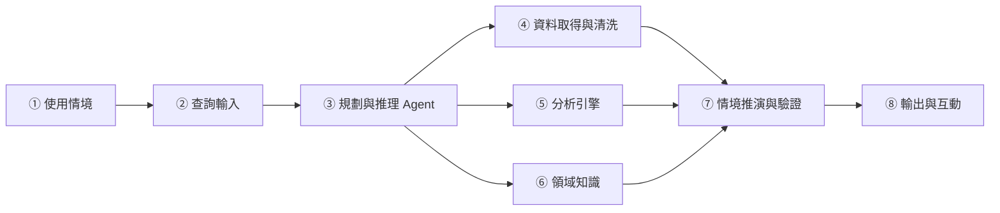

# DESIGN.md — GridReserve Agent

> 版本：v0.1（Proposal 階段）｜更新日期：2026-10-31
> 本文件從 Proposal 階段開始建立，之後隨實作持續維護。標示「待辦」的項目尚未實作；「Results」尚未有任何實驗結果。

## 1. Problem 問題

台灣尖峰與夜尖峰用電逐年創高，供給端的機組故障、新機組延遲會讓備轉容量率快速下降。台電公開的營運資料免費，但：

1. 每日備轉容量率主要是調度後的結果，與氣溫幾乎無關，不適合直接預測。
2. 備轉的定義有日夜之別（自民國 111 年起歷年統計以夜間呈現），也有快慢速品質差異。
3. 一般使用者難以回答「若某機組跳機，備轉與燈號會怎樣」，而 LLM 直接回答容易產生沒有依據的數字。

**目標**：建立一個領域 AI Agent，以公開資料預測負載、推演機組停機情境、歸因低備轉日，且所有數字可追溯。

## 2. Requirements 需求

| 編號 | 需求 | 驗收方式 |
|---|---|---|
| R1 | 預測指定日期的尖峰負載，並給 10/50/90% 分位數 | E1：MAE、pinball loss、區間涵蓋率 |
| R2 | 推演機組停機後的備轉容量、備轉容量率與燈號 | E2：2025-09 事故回測；E4 規則測試 |
| R3 | 對低備轉日列出主要貢獻機組群組 | E2 案例比對 |
| R4 | 輸出中的每個數字都能追溯到工具輸出 | E3：溯源率、幻覺率 |
| R5 | 資料涵蓋範圍外（日期、夜尖峰、民營電廠）時安全拒答 | E3 陷阱題 |
| R6 | 他人可依 README 與本文件重現 | 乾淨環境執行測試 |

## 3. Architecture 架構



流程要點（完整流程圖見 Proposal 圖 2）：資料涵蓋檢查 → 意圖判斷 → 工具調用 → 備轉與燈號計算 → 領域知識檢索 → 生成說明 → 溯源驗證（失敗最多重生成 2 次，仍失敗則安全失敗）。

## 4. Components 元件

| 模組 | 職責 | 預計檔案 |
|---|---|---|
| ③ Planner | 解析意圖（FORECAST / WHATIF / DIAGNOSE / EXPLAIN）、拆解任務、調用工具 | `src/agent/planner.py` |
| ④ Data | 讀取 CSV、驗證、清洗、合併 | `src/data/loaders.py`, `src/data/cleaning.py` |
| ⑤ Analytics | 負載預測、分位數區間、低備轉日偵測、歸因 | `src/analytics/load_model.py`, `attribution.py` |
| ⑥ Knowledge | 燈號規則、機組知識庫、備轉品質標註、RAG | `src/knowledge/`, `kb/` |
| ⑦ Scenario & Verify | 備轉計算、燈號判定、溯源檢查 | `src/agent/scenario.py`, `verify.py` |
| ⑧ UI | Streamlit 介面 | `app/streamlit_app.py` |

## 5. Data 資料

資料放在 `data/raw/`（原始檔，不修改）與 `data/processed/`（清洗後）。每次下載記錄來源網址、日期與 SHA-256。

| 檔案 | 筆數 | 期間 | 用途 |
|---|---|---|---|
| 近三年每日尖峰備轉容量率 | 1,096 | 2023-01-01 至 2025-12-31 | 歷史備轉、反推負載 |
| 過去電力供需資訊 | 608 | 2025-01-01 至 2026-08-31 | 機組、太陽能、風力出力 |
| 未來二個月電力供需預測 | 6 | 2026-11-01 至 2026-12-21 | 僅展示，無法回測 |
| 氣象日資料 466920 / 467490 / 467441 | 各 1,339 | 2023-01-01 至 2026-08-31 | 負載預測特徵 |
| 水火力發電廠位置及機組設備 | 175 部機組 | — | 機組知識庫 |

### 清洗規則（已由資料探索確認，待實作）

1. **備轉容量率重算**：`rate = 備轉容量 / 尖峰負載 * 100`。主檔有 6 筆被放大約 10 倍：2025-03-29、2025-04-27、2025-10-20、2025-10-25 可與近三年檔交叉驗證；2026-04-05、2026-04-17 無對照，以重算值為準。
2. **降水量**：`-9.8`（微量降雨）→ `0`。氣壓等不使用的欄位直接捨棄；氣象檔 279 欄中只保留約 10 欄。
3. **機組欄位**：排除全為 0 的 6 欄（核一、核二、核三 #1、麥寮 #2 等）。
4. **單位**：機組設備檔為瓩，轉為萬瓩（÷ 10,000）。
5. **日期**：`YYYYMMDD` 整數 → date。
6. **合併**：2023-01-01 至 2025-12-31 取近三年檔，2026-01-01 起取主檔；2025 年重疊 365 天用於交叉驗證。
7. **反推**：`load = 備轉容量 / (備轉容量率/100)`，`supply = load + 備轉容量`；與主檔重疊期比對，平均相對誤差約 0.014%。
8. **機組設備檔**：商轉日期有 52 筆只有 6 碼（均為水力機組），不影響容量欄位；缺新機組與民營電廠（見 Limitations）。

## 6. AI / Analytics

- **負載預測**：特徵＝星期、月份、假日、趨勢、三站最高/平均氣溫、溼度、降水、日照。模型從嶺回歸、梯度提升開始，輸出 10/50/90% 分位數，並以 conformal 方法校準區間。
- **防資料洩漏**：同日機組、太陽能、風力出力只用於事後診斷，不進入預測特徵。
- **歸因**：事件日與前 7 週同星期平均比較，列出出力變化最大的機組群組。出力不等於可用容量，結果需標註此限制。
- **LLM**：只負責意圖解析、任務規劃與文字生成；數字一律來自工具輸出。

## 7. Domain Knowledge 領域知識

- **燈號規則**（設定檔 `kb/lights.yaml`）：
  - 備轉容量 ≤ 50 萬瓩：黑燈；≤ 90 萬瓩：紅燈（絕對值）。
  - 備轉容量率 ≤ 6%：橘燈；6% 至 10%：黃燈；≥ 10%：綠燈（比率）。
- **機組知識庫**（`kb/units.csv`）：電廠、機組、燃料、裝置容量（萬瓩）、快慢速分類（人工標註，待辦）。
- **最大單機指標**：`N-1 ratio = 備轉容量 / 最大單機容量`；目前設備檔中最大單機為台中新 1、2 號機容量，皆為130萬瓩。
- **日夜尖峰**：每個輸出標註尖峰類型；目前資料無法直接得到夜尖峰備轉，夜間重建為選配功能。

## 8. Algorithm 演算法

核心演算法（Algorithm 1: GridReserve Agent 與 Algorithm 2: ClassifyLight）的帶行號偽代碼見 Proposal 第 5.5 節。實作時以 `src/agent/planner.py` 的 `run(query)` 對應 Algorithm 1，以 `src/knowledge/lights.py` 的 `classify_light(R_cap, r)` 對應 Algorithm 2。

## 9. Implementation Mapping 實作對照

| Proposal 項目 | 程式位置 | 狀態 |
|---|---|---|
| ④ 資料取得與清洗 | `src/data/` | 待辦 |
| ⑤ 負載預測 | `src/analytics/load_model.py` | 待辦 |
| ⑤ 歸因 | `src/analytics/attribution.py` | 待辦 |
| ⑥ 燈號規則 | `src/knowledge/lights.py`, `kb/lights.yaml` | 待辦 |
| ⑥ 機組知識庫 | `kb/units.csv` | 待辦 |
| ⑦ 情境推演與驗證 | `src/agent/scenario.py`, `verify.py` | 待辦 |
| ③ Planner | `src/agent/planner.py` | 待辦 |
| ⑧ UI | `app/streamlit_app.py` | 待辦 |
| E1–E4 實驗 | `experiments/`, `tests/` | 待辦 |

預計目錄結構：

```text
.
├── README.md
├── DESIGN.md
├── data/{raw,processed}/
├── kb/{lights.yaml,units.csv}
├── src/{data,analytics,knowledge,agent}/
├── app/streamlit_app.py
├── experiments/
└── tests/
```

## 10. How to Run（待辦，實作後補齊）

```bash
# 預計流程
python -m venv .venv && source .venv/bin/activate
pip install -r requirements.txt
python -m src.data.cleaning          # 產生 data/processed/
pytest                               # 燈號規則與清洗規則測試
streamlit run app/streamlit_app.py
```

## 11. Experiments 與 Results

| 實驗 | 內容 | 狀態 |
|---|---|---|
| E1 | 負載預測；訓練 2023-01-01 至 2025-08-31，測試 2025-09-01 至 2026-08-31 | 尚未進行 |
| E2 | 2025-09 事故情境回測 | 尚未進行 |
| E3 | 約 40 題 Agent 評估：純 LLM / LLM+RAG / 完整 Agent | 尚未進行 |
| E4 | 燈號邊界測試（10%、6%、90、50） | 尚未進行 |

**Results：尚無。**以下僅為初步資料探索（非實驗結果）：負載與三站平均最高氣溫相關約 0.75；備轉容量率與氣溫相關約 −0.07；供電能力與負載相關約 0.92；備轉容量率的簡單基準平均誤差約 5.8–6.2 個百分點。

## 12. Limitations 限制

1. 備轉容量率是調度結果，無法由氣象可靠預測；本專案不以它為預測目標。
2. 公開資料沒有夜尖峰備轉；日尖峰數字不能代表夜間風險。
3. 機組設備檔最新商轉日為 2023-06-27，缺新機組與民營電廠、風力、太陽能。
4. 氣象使用觀測值，是預報完全準確的上限；需以加入雜訊做敏感性分析。
5. 歷史資料僅約 3.7 年，且無橘燈事件；不適合重度深度學習或橘燈分類。
6. 歸因使用出力變化，不等於可用容量變化。

## 13. Decision Log 設計決策紀錄

| 日期 | 決策 | 原因 |
|---|---|---|
| 2026-10-31 | 不直接預測備轉容量率，改做負載預測加情境推演 | 初步探索顯示備轉容量率與氣溫無關，且簡單基準已接近標準差 |
| 2026-10-31 | 不用官方未來二個月預測當 Baseline | 僅 6 筆、無歷史快照，無法回測 |
| 2026-10-31 | LLM 不產生數字，設驗證關卡 | 降低幻覺風險，確保可追溯 |
| 2026-10-31 | 備轉容量率一律重算 | 主檔有 6 筆錯誤值 |

## 14. References

完整參考文獻見 Proposal 文件第 7 章（共 31 筆）。