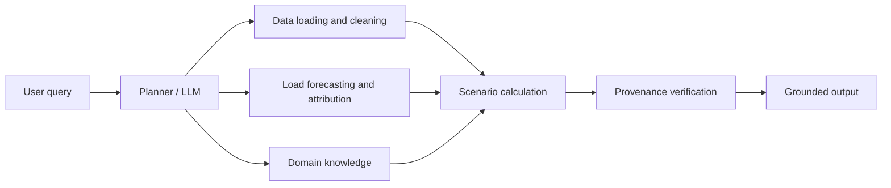

# GridReserve Agent

氣象驅動負載預測與機組情境推演之台灣電網備轉風險 Domain AI Agent  
Taiwan Power Reserve-Risk Domain AI Agent

> **Project status:** Proposal / planned implementation  
> This repository currently contains the system design and proposal documents. The
> data pipeline, models, Agent, Streamlit interface, and experiments are planned
> components and should not be interpreted as completed or validated results.

## Overview

GridReserve Agent is a proposed domain AI system for exploring Taiwan's power
reserve risk with public power-system and weather data. Instead of directly
predicting reserve capacity rate—which is strongly affected by dispatch
decisions—the system separates the problem into:

1. probabilistic peak-load forecasting;
2. generator-outage scenario analysis;
3. low-reserve-day attribution; and
4. grounded explanation with source tracing and safe refusal.

The LLM is intended to understand user questions, plan tool calls, and explain
results. It must not invent numerical values. Numerical outputs are produced by
data-processing and analysis tools, then checked by a provenance-verification
gate before they are shown to users.

## Intended users and questions

The intended users are power and energy researchers, policy analysts, and members
of the public interested in Taiwan's power-supply situation. Example questions
include:

- How much will tomorrow's peak load be?
- If a specified generator trips, how will reserve capacity, reserve rate, and
  the supply light change?
- Why was the reserve rate unusually low on 2025-09-23?
- What are the limitations of using reserve capacity as a risk indicator?

The planned Agent supports four intents:

| Intent | Purpose |
|---|---|
| `FORECAST` | Forecast peak load with 10th, 50th, and 90th percentiles |
| `WHATIF` | Simulate one or more generator outages |
| `DIAGNOSE` | Attribute a low-reserve day to generator-output changes |
| `EXPLAIN` | Explain reserve concepts, light rules, and limitations |

## System architecture



The planned flow is:

1. Check whether the requested date, peak type, and generator are covered.
2. Parse the user's intent and entities.
3. Load and clean the relevant public data.
4. Call forecasting, scenario, attribution, or knowledge tools.
5. Calculate reserve capacity and supply-light status.
6. Verify that every output number has a tool result, unit, and date.
7. Return evidence, uncertainty, and limitations—or refuse safely if the request
   cannot be supported.

## Core calculations

For a scenario, let:

- `L` be the peak load;
- `S` be the reference supply capability after scenario adjustments;
- `R` be reserve capacity; and
- `r` be reserve capacity rate.

The planned calculations are:

```text
R = S - L
r = R / L * 100
N-1 ratio = R / largest single-unit capacity
```

The light classification checks absolute reserve capacity before reserve rate:

| Condition | Light |
|---|---|
| `R <= 50` (500,000 kW; 50 萬瓩) | Black |
| `R <= 90` (900,000 kW; 90 萬瓩) | Red |
| `r <= 6%` | Orange |
| `r < 10%` | Yellow |
| otherwise | Green |

The exact boundary behavior should remain covered by automated rule tests.

## Data

The proposal uses public Taiwan Power Company and Central Weather
Administration data. The planned coverage is **2023-01-01 to 2026-08-31**
(1,339 days).

| Dataset | Coverage / size | Planned use |
|---|---:|---|
| Recent daily peak reserve-rate data | 1,096 days, 2023-01 to 2025-12 | Historical reserve and load reconstruction |
| Historical power supply and demand | 608 records, 2025-01 to 2026-08 | Generator, solar, and wind output |
| Two-month power-supply forecast | 6 records, 2026-11 to 2026-12 | Demonstration only; not a backtest baseline |
| Daily weather observations | 1,339 days per station; Taipei, Taichung, Kaohsiung | Load-forecast features |
| Hydropower and thermal generator equipment | 175 units | Generator knowledge base and outage scenarios |

Raw data should be preserved under `data/raw/`; cleaned data should be written
to `data/processed/`. Each download should record its source URL, retrieval
date, and SHA-256 checksum.

Planned cleaning rules include:

- recompute reserve rate as `reserve capacity / peak load * 100`;
- convert precipitation `-9.8` (trace precipitation) to `0`;
- remove all-zero generator columns;
- convert generator capacity from kW to 10,000 kW;
- convert `YYYYMMDD` integers to dates;
- use the three-year dataset through 2025 and the main dataset from 2026;
- use the overlapping 2025 period for cross-validation; and
- prevent same-day generator, solar, and wind output from entering the load
  forecast features.

## Planned repository structure

```text
.
├── README.md
├── DESIGN.md
├── data/
│   ├── raw/
│   └── processed/
├── kb/
│   ├── lights.yaml
│   └── units.csv
├── src/
│   ├── agent/
│   ├── analytics/
│   ├── data/
│   └── knowledge/
├── app/
│   └── streamlit_app.py
├── experiments/
└── tests/
```

The implementation mapping and design decisions are documented in
[`DESIGN.md`](./DESIGN.md).

## Planned implementation and usage

The following commands describe the intended workflow after implementation.
They are not currently executable because the implementation files and
dependency manifest have not yet been added.

```bash
python -m venv .venv
# Windows PowerShell:
.venv\Scripts\Activate.ps1
pip install -r requirements.txt

python -m src.data.cleaning
pytest
streamlit run app/streamlit_app.py
```

## Evaluation plan

| Experiment | Purpose | Metrics |
|---|---|---|
| E1: Load forecasting | Compare weather-aware probabilistic forecasts with baselines | MAE, MAPE, pinball loss, 80% interval coverage |
| E2: Outage backtest | Reconstruct the September 2025 Xingda and Linkou incidents | Reserve-change error and light agreement |
| E3: Agent evaluation | Compare plain LLM, LLM+RAG, and the complete Agent on about 40 questions | Numeric accuracy, provenance rate, refusal accuracy, hallucination rate |
| E4: Rule tests | Test light-rule boundaries | Pass rate |

The proposal contains preliminary data exploration, not formal experimental
results. Expected outcomes must therefore be validated before being reported as
findings.

## Limitations

- Reserve capacity rate is primarily a dispatch outcome and is not the direct
  forecasting target.
- The available public data does not directly provide night-peak reserve
  capacity; night-peak answers must be refused or explicitly labeled as
  reconstructed estimates.
- The equipment data is incomplete for newer units, private plants, wind, and
  solar generation.
- Weather observations represent an optimistic upper bound because actual
  weather forecasts contain error.
- The historical period is short and contains no orange-light events in the
  preliminary exploration, limiting rare-event evaluation.
- Output change is not the same as available-capacity change, so attribution
  results require this qualification.
- This project is an analysis and education prototype, not an operational grid
  control or dispatch system.

## Data sources

The proposal's source list includes:

- Taiwan Power Company open data on power supply and demand, reserve rates,
  two-month forecasts, and generator equipment;
- Central Weather Administration CODiS daily observations for stations
  `466920`, `467490`, and `467441`; and
- the news reports and research papers listed in the proposal.

See the proposal document for the complete reference list and source URLs.